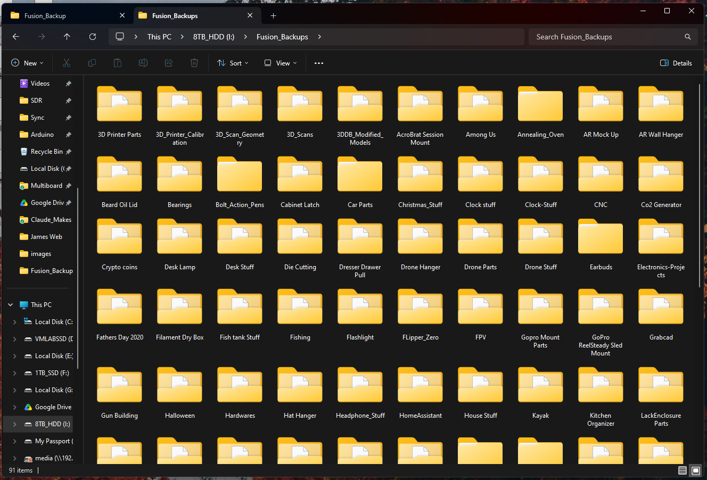
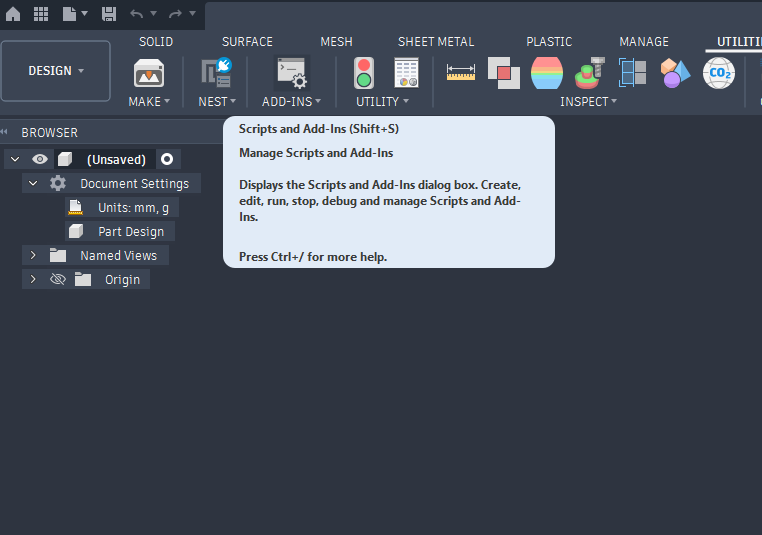
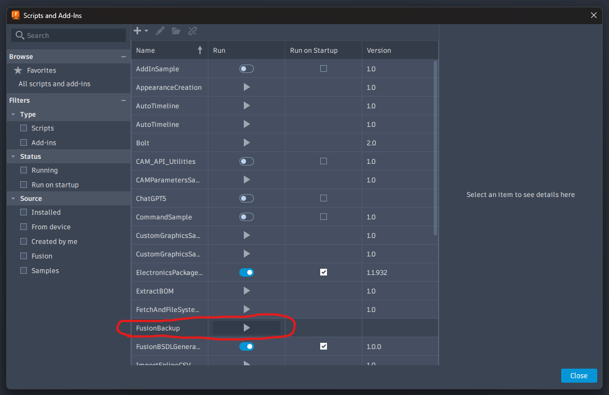
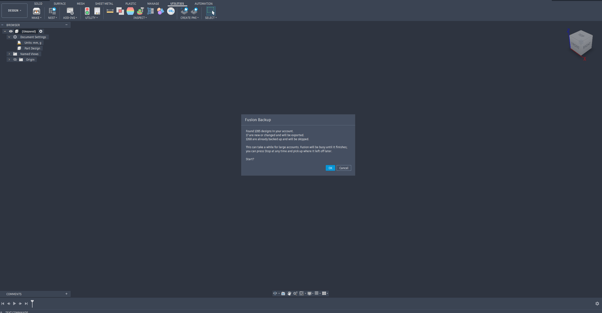
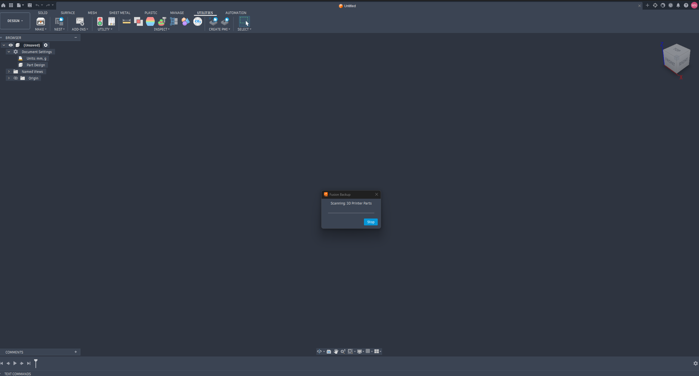
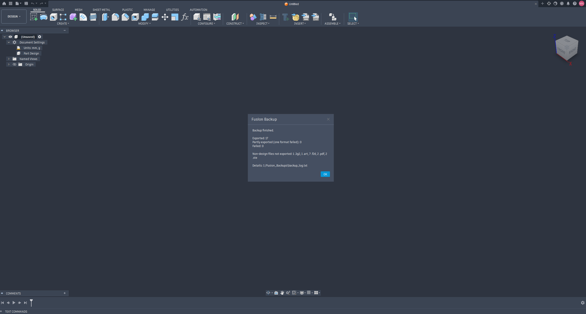

# FusionBackup

**Back up every design in your Autodesk Fusion account to your own drive, as `.f3d` and `.step`, in one click.**

Fusion keeps your designs on Autodesk's servers instead of your computer. That's convenient until your account gets locked, a licence changes, the service goes down, or your content is removed after a long stretch without logging in. FusionBackup is a small script that runs inside Fusion. It goes through every project you have access to and saves a local copy of each design, laid out in the same folders you use in the cloud.

<!-- SCREENSHOT: the finished backup folder open in File Explorer / Finder, showing project folders with .f3d and .step files inside -->


---

## Contents

- [Features](#features)
- [Why two formats?](#why-two-formats)
- [Requirements](#requirements)
- [Installation](#installation)
- [Running a backup](#running-a-backup)
- [What you get](#what-you-get)
- [How incremental backups work](#how-incremental-backups-work)
- [Settings](#settings)
- [Limitations and known behaviour](#limitations-and-known-behaviour)
- [Troubleshooting](#troubleshooting)
- [Restoring a design](#restoring-a-design)
- [FAQ](#faq)
- [Contributing](#contributing)
- [License](#license)

---

## Features

- **Whole-account backup.** Covers every hub, project, folder and subfolder you can see in the Fusion Data Panel.
- **Two formats per design.** A `.f3d` (the native Fusion archive, timeline and all) and a `.step` (neutral CAD that opens almost anywhere).
- **Mirrors your cloud layout.** `Project / Folder / Subfolder / Design.f3d`, so things are easy to find.
- **Incremental.** After the first run, only new or changed designs are exported, so later runs are fast.
- **Safe to stop.** Press **Stop** at any time. Nothing is lost, and the next run carries on where this one left off.
- **Read-only to the cloud.** Designs are opened in the background and closed *without saving*. Your Autodesk data is never modified.
- **Doesn't disturb your open work.** If a design is already open in Fusion, it's exported from the open copy and left open.
- **Full log.** Every success, partial success and failure is written to `backup_log.txt`.
- **No extra software.** Pure Python using Fusion's built-in API. Nothing to install with pip, no API keys, no Autodesk developer account.

## Why two formats?

| Format | What it keeps | Opens in | Use it for |
|---|---|---|---|
| **`.f3d`** | Everything: parametric timeline, sketches, constraints, parameters, joints, appearances | Autodesk Fusion only | Re-uploading to Fusion and carrying on editing exactly where you left off |
| **`.step`** | Final solid and surface geometry (no history) | FreeCAD, SOLIDWORKS, Onshape, Inventor, Rhino, KiCad, slicers and most other CAD tools | Long-term archiving, moving to other software, sharing with others |

`.f3d` is the best copy *as long as you have Fusion*. `.step` is your insurance if you ever don't.

## Requirements

- **Autodesk Fusion** (Personal, Startup, Education or Commercial licence) on **Windows** or **macOS**
- Signed in to the Autodesk account you want to back up
- An internet connection, since each design downloads from Autodesk as it's exported
- Enough free disk space. Budget roughly 1–10 MB per design; large assemblies can be much bigger.

## Installation

### 1. Download

Either:

- **Download a ZIP:** click the green **Code** button above → **Download ZIP**, then unzip it, *or*
- **Clone with git:**
  ```bash
  git clone https://github.com/<your-username>/<repo-name>.git
  ```

You'll find a folder called **`FusionBackup`** containing:

```
FusionBackup/
├── FusionBackup.py         # the script
└── FusionBackup.manifest   # tells Fusion what the script is
```

> ⚠️ Keep the folder name, `.py` name and `.manifest` name the same (`FusionBackup`). Fusion uses the folder name to find the script.

### 2. Add the script to Fusion

**Option A: add it from wherever you saved it (easiest)**

1. In Fusion, open **Utilities → Add-Ins → Scripts and Add-Ins** (or press **Shift + S**).
2. Click the **+** button and choose **Script or add-in from device**.
3. Select the `FusionBackup` folder.

<!-- SCREENSHOT: the Scripts and Add-Ins dialog with the + menu open -->


**Option B: copy it into Fusion's Scripts folder**

Copy the whole `FusionBackup` folder into:

| OS | Folder |
|---|---|
| Windows | `%appdata%\Autodesk\Autodesk Fusion 360\API\Scripts` |
| macOS | `~/Library/Application Support/Autodesk/Autodesk Fusion 360/API/Scripts` |

Then restart Fusion or reopen the Scripts and Add-Ins dialog. **FusionBackup** will appear in the list.

## Running a backup

1. Open **Utilities → Add-Ins → Scripts and Add-Ins**, select **FusionBackup** and click **Run**.

   <!-- SCREENSHOT: FusionBackup selected in the Scripts list with the Run button visible -->
   

2. **Choose a backup folder.** Pick any local drive, external drive, or a mapped NAS / network share. The script remembers this choice and suggests it next time.

   <!-- SCREENSHOT: the folder picker dialog -->
   

3. **Wait for the scan.** The script lists every design in your account. On large accounts this takes a minute or two.

4. **Confirm.** A summary tells you how many designs were found, how many are new or changed, and how many are already backed up and will be skipped. Click **OK** to start.

   <!-- SCREENSHOT: the "Found X designs..." confirmation message -->
   

5. **Let it run.** A progress bar shows which design is being exported. Fusion stays busy until the run finishes. To pause, click **Stop**; the current design finishes first, then the script stops.

   <!-- SCREENSHOT: the progress dialog mid-backup -->
   

6. **Review the results.** At the end you'll see how many designs were exported, partly exported, or failed, plus the path to the log.

   <!-- SCREENSHOT: the "Backup finished" summary message -->
   

> 💡 **The first run is the slow one.** Every design has to be downloaded, opened and exported, which can take hours on a big account. Start it before bed or when you won't need Fusion. Later runs only handle what changed.

## What you get

```
<Your backup folder>/
├── backup_log.txt               ← running history of every backup
├── backup_state.json            ← what has been backed up (don't delete unless you want a full re-export)
├── Drone Frame/                 ← one folder per Fusion project
│   ├── Arm v2.f3d
│   ├── Arm v2.step
│   └── Electronics/             ← Fusion folders become subfolders
│       ├── FC Mount.f3d
│       └── FC Mount.step
└── Ring/
    ├── Band.f3d
    └── Band.step
```

- If your account belongs to **more than one hub** (for example a personal hub plus a team hub), an extra top-level folder is added for each hub.
- Characters Windows and macOS don't allow in file names (`< > : " / \ | ? *`) are replaced with `_`, and very long names are shortened.
- Two designs with the **same name in the same folder** are kept apart with a short ID suffix, e.g. `Bracket [a1B2c3].f3d`.

## How incremental backups work

Every design in Fusion has a version number that goes up each time it's saved. After a design is exported, its ID, version and file paths are recorded in `backup_state.json` in your backup folder.

On the next run a design is **skipped** if:

- its version number hasn't changed, **and**
- its backed-up files still exist on disk.

So if you delete a backed-up file by hand, it's exported again next time. To force a **full re-export** of everything, delete `backup_state.json`.

Because the state file lives *inside* the backup folder, you can keep separate backups (e.g. an external drive and a NAS), each with its own independent state.

## Settings

A few options sit at the top of `FusionBackup.py`:

```python
EXPORT_F3D = True     # save the native Fusion archive
EXPORT_STEP = True    # save a STEP file
MAX_NAME_LEN = 80     # shortens long names to keep Windows paths under 260 characters
OPEN_RETRIES = 2      # retries if a design fails to download/open
```

Open the file in any text editor (or click **Edit** in the Scripts and Add-Ins dialog), change a value, save, and run again.

## Limitations and known behaviour

- **Only Fusion designs are exported.** Drawings, electronics designs, and files you uploaded to Fusion (PDFs, STLs, images, etc.) are skipped. The summary tells you how many of each type were skipped.
- **Sketch-only designs get an `.f3d` but no `.step`.** STEP needs solid or surface geometry. These show as *partly exported* in the log, which is expected.
- **Designs with linked (external) components** may be saved as `.f3z` instead of `.f3d`. That's still a full Fusion archive, which also bundles the referenced designs.
- **Only the latest version is kept locally.** When a design changes, its backup files are overwritten. If you want history, back up the backup folder with a tool that keeps versions (File History, Time Machine, NAS snapshots, etc.).
- **Deleted cloud designs stay in your backup.** The script never deletes local files. That's deliberate: it's a backup.
- **Renamed or moved designs** are only exported to their new location the next time they change, because renaming doesn't bump the version number. Delete `backup_state.json` to rebuild the whole tree.
- **Fusion is busy while it runs.** The script uses Fusion's own export engine, so you can't model at the same time.
- **Shared projects:** anything you can open, you can back up. Respect the owner's wishes when backing up other people's work.

## Troubleshooting

**Start with `backup_log.txt`** in your backup folder. Every design gets one line:

```
[2026-10-24 21:14:03] OK      Drone Frame/Electronics/FC Mount (v12)
[2026-10-24 21:14:19] PARTIAL Drone Frame/Sketches/Layout (v3): {'step_error': '...'}
[2026-10-24 21:14:40] FAIL    Ring/Old Concept (v1): could not open: ...
```

| Problem | Likely cause / fix |
|---|---|
| FusionBackup isn't listed in Scripts and Add-Ins | The folder, `.py` and `.manifest` names don't match, or the folder is nested one level too deep (e.g. `FusionBackup/FusionBackup/`). |
| `FAIL ... could not open` | Network hiccup or an Autodesk server timeout. Just run again; only the failed designs will be retried. |
| `PARTIAL ... step_error` | Usually a design with no solid bodies (sketch-only). The `.f3d` was still saved. |
| A file path error on Windows | The path is too long. Choose a backup folder closer to the drive root (e.g. `D:\FusionBackup`) or lower `MAX_NAME_LEN`. |
| Fusion looks frozen | It's working. Large designs can take a minute or more to download and export. Check that the progress bar moves between designs. |
| Every design exports again on each run | `backup_state.json` can't be written. Check that you have write permission to the backup folder. |

If you hit something else, please [open an issue](../../issues) and include the relevant lines from `backup_log.txt` and your Fusion version.

## Restoring a design

- **Back into Fusion:** open the Data Panel → **Upload** → select the `.f3d`/`.f3z`. Or use **File → Open → Open from my computer**. The full timeline comes back.
- **Into another CAD program:** open or import the `.step` file.

## FAQ

**Does this upload, change or delete anything in my Autodesk account?**
No. It only reads. Designs are opened in the background and closed without saving.

**Does it need an Autodesk API key or developer account?**
No. It uses the scripting API built into Fusion and your normal sign-in.

**Can I schedule it to run automatically?**
Fusion scripts can't start on their own while Fusion is closed, so you start each run yourself. Because runs are incremental, a monthly (or weekly) run usually takes just a few minutes. Running it regularly also means you log in regularly, which keeps your account from counting as inactive.

**Can I back up to a NAS or network drive?**
Yes. Choose a mapped drive or network share in the folder picker. A local drive is faster for the first big run if you want to copy it over afterwards.

**Does it work on the free / Personal licence?**
Yes. `.f3d` and `.step` export are both available on the Personal licence.

## Contributing

Bug reports, fixes and ideas are welcome. Open an issue or a pull request. When reporting a problem, please include:

- your OS and Fusion version
- the relevant lines from `backup_log.txt`
- roughly how many designs and projects are in your account

## License

Released under the [MIT License](LICENSE).

---

*Not affiliated with or endorsed by Autodesk. Autodesk and Fusion are trademarks of Autodesk, Inc.*
